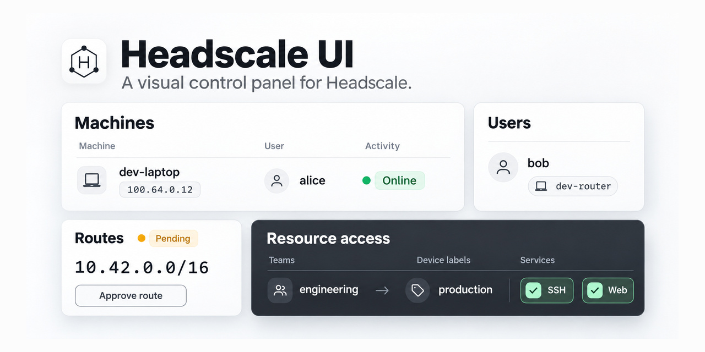

# Headscale UI

Manage your Headscale network from your browser.

Machines, users, auth keys, routes, and access policies—all in one interface.

**[Open Headscale UI](https://headscale.lyz.cloud)** · [Getting started](#getting-started) · [Self-hosting](#self-hosting) · [Report an issue](https://github.com/MunMunMiao/headscale-ui/issues)



## Use it online

Open **[headscale.lyz.cloud](https://headscale.lyz.cloud)** to get started. Connect your own Headscale server to explore the interface and use it for everyday administration.

The hosted app requires no UI installation or build. Your Headscale server can run on another machine or network.

You will need:

- A running Headscale server with an HTTPS endpoint accessible from your browser.
- A Headscale management API key.
- A reverse proxy configured to allow requests from `https://headscale.lyz.cloud`.

The app connects to your own server, so management actions affect that server. See [Connecting to Headscale](#connecting-to-headscale) for the network and proxy requirements.

> Independent project; not an official Headscale, Tailscale, or WireGuard product.

## Features

- **Machines and users** — browse, search, register, and manage devices and users.
- **Auth keys** — create reusable or ephemeral keys with expiration and ACL tags, and generate device connection commands.
- **Routes** — approve subnet routes and exit routes.
- **Access policies** — visually manage ACLs, groups, and tag owners, and validate drafts with Headscale before saving.
- **SSH approvals** — approve or reject SSH check requests.
- **Multiple servers** — switch between profiles with individually password-encrypted API keys.
- **11 languages** — including Arabic RTL support, with light, dark, and system themes.

## Getting started

### 1. Prepare an API key

On the machine running Headscale, create a management API key:

```bash
headscale apikeys create
```

Use a management API key, rather than a pre-auth key used to register devices. See the [Headscale API documentation](https://headscale.net/stable/ref/api/) for details.

### 2. Allow the hosted app to connect

Configure the reverse proxy in front of Headscale to allow the UI origin:

```text
https://headscale.lyz.cloud
```

The required CORS settings are described [below](#connecting-to-headscale).

### 3. Open the app and add your server

Visit **[headscale.lyz.cloud](https://headscale.lyz.cloud)** and add a server profile:

| Field            | What to enter                                                                              |
| ---------------- | ------------------------------------------------------------------------------------------ |
| Server URL       | Your Headscale base URL, such as `https://headscale.example.com`. Do not append `/api/v1`. |
| API key          | The management API key created on your Headscale server.                                   |
| Profile password | A password of at least 8 characters to encrypt the API key stored in this browser.         |

The profile password is chosen for the UI. It is separate from your server's operating-system password.

A profile can be saved while its server is unavailable. Opening the management console requires a successful connection.

### 4. Manage your network

Once connected, use the console to manage machines, users, keys, routes, and access policies.

You can return to the same website for ongoing use and unlock your saved profile when needed.

## Connecting to Headscale

### Requests come from your browser

The browser sends authenticated requests directly to your configured Headscale endpoint. The UI hosting server serves the application files; it does not act as an API relay.

Your browser's machine must therefore be able to resolve and reach the Headscale URL. If Headscale is on a private network, connect that machine to the required network or VPN.

Use HTTPS with a certificate trusted by the browser. An HTTPS UI cannot call a plain-HTTP API because browsers block mixed content.

### Using the hosted app: configure CORS

The hosted app and your Headscale server have different origins. Configure CORS on the **reverse proxy in front of Headscale**.

Responses should include:

```http
Access-Control-Allow-Origin: https://headscale.lyz.cloud
Access-Control-Allow-Methods: GET, POST, PUT, DELETE, OPTIONS
Access-Control-Allow-Headers: Authorization, Content-Type
Vary: Origin
```

The proxy must also:

- Answer preflight `OPTIONS` requests with `204`, without requiring an API key.
- Include CORS headers on preflight, actual, and error responses.
- Forward the actual requests' `Authorization` header to Headscale.
- Apply this configuration to `/api/v1/*` and `/version`.

Headscale still authenticates actual API requests. Stock Headscale does not provide the CORS responses required by this setup.

For a separately hosted UI, replace the allowed origin with its exact scheme, hostname, and port if applicable. An origin does not include a path or trailing slash.

### Self-hosting on the same origin

If you host the UI yourself, you can serve both services through one HTTPS origin:

| Service                                | Example address                        |
| -------------------------------------- | -------------------------------------- |
| Headscale UI                           | `https://headscale.example.com/admin/` |
| Headscale server URL entered in the UI | `https://headscale.example.com`        |

Run the UI with `BASE_PATH=/admin/` and use these locations in your TLS reverse proxy:

```nginx
location = /admin {
    return 308 /admin/$is_args$args;
}

location /admin/ {
    proxy_pass http://headscale-ui:80;
}

location / {
    proxy_pass http://headscale:8080;
}
```

Replace the upstream addresses with your own. The services can run on different machines as long as the proxy can reach both.

Preserve the `/admin/` prefix: the UI's `proxy_pass` has no trailing slash. The catch-all forwards Headscale's API and control endpoints. No CORS configuration is needed when the browser sees one origin.

## Credentials and sessions

API keys are stored in your browser's IndexedDB, encrypted with AES-256-GCM using a per-profile password-derived key. Passwords and derived encryption keys are not saved.

While unlocked, a SharedWorker holds the API key in memory and sends authenticated requests to your Headscale server.

- Sessions lock after 30 minutes without qualifying user activity.
- Logout locks the shared session across tabs.
- Profiles are stored in that browser; they do not automatically follow you to another device.
- There is no profile password recovery. If you forget it, replace the stored credentials or delete the profile.
- Logout does not revoke the Headscale API key. Revoke it on Headscale when necessary.

Use a UI origin you trust. Encryption protects stored credentials while locked; it does not protect an unlocked session from malicious scripts, browser extensions, or a compromised device.

<details>
<summary>Session behavior and recovery</summary>

Same-origin tabs in one browser storage partition share one active server. A successful server switch affects those tabs; a failed unlock preserves the existing session.

Visible-page user activity extends the session. Polling, synthetic events, mouse movement, and page focus do not. Refreshing rejoins a live Worker session when available; otherwise, the profile password is required. Closing the last tab does not guarantee immediate Worker memory erasure.

Session changes clear generated credentials. Drafts from a previous server cannot be submitted to the new server. Locking discards unsaved Access edits and reports this on login.

If a write loses its response, it may already have committed. The app does not automatically retry writes; check the server state before trying again.

The remember option controls profile visibility. To remove stored credentials, explicitly delete the profile or clear local data; temporary encrypted records can survive reload or browser session restoration.

Legacy credential records migrate explicitly, one profile at a time. Failed migrations preserve the original record. Conflicting writes require a retry, and changing active credentials locks the session.

Before upgrading, close or refresh old UI tabs. Storage uses database version 3; older open connections can block an upgrade. Do not downgrade or clear the database as an upgrade workaround. A rollback build must support version 3, or use an independently preserved pre-upgrade browser profile.

</details>

## Compatibility

The current UI targets **Headscale 0.29.x**.

A browser with **SharedWorker** and **Web Crypto** support is required. Serve the UI over HTTPS, or use loopback localhost for local development. If the Worker is unavailable or incompatible, administration is blocked.

### Access policies

To save policy changes through the UI, configure Headscale with:

```yaml
policy:
  mode: database
```

The Access page supports server-side validation without saving.

The visual editor reads JSON and HuJSON. Saving normalizes the policy to JSON and removes comments and formatting. Unsupported or invalid policy structures become read-only to preserve the original document.

<details>
<summary>Policy editing details</summary>

- Visual network rules can connect policy labels. New source choices come from declarations in the current draft. Adding access does not change tag owners or create a reverse rule.
- New access rows default to network port 22. Confirm custom ports before clearing the last preset.
- Unmodeled top-level and ACL fields, including `proto`, survive edits. Split destinations retain their restrictions. Aggregate service controls become read-only when contributing ACLs have extra fields; explicit access removal remains available.
- Group and tag renames or deletions update supported references, including SSH, grants, route approvers, and tests. Unknown reference structures block the operation while preserving the draft.
- Renaming a policy tag does not retag devices.
- Empty ACLs stay empty. Grants-only policies do not gain an allow-all ACL. Grants have no dedicated visual editor.
- Invalid or unrepresentable policies block policy saves and related member changes. Correct the policy in Headscale and refresh to resume editing. Member deletion can proceed with policy cleanup explicitly disabled.
- File mode without a policy path is read-only. With a path, reads work, but API saves fail with an explanation and retain the draft.
- Saving replaces the whole policy without a concurrent-update check. Coordinate edits when multiple administrators are working on the same policy.
- The returned policy becomes the saved baseline while newer local edits remain intact. Member policy actions write only their own change and are disabled while Access has unsaved edits.

Headscale performs semantic validation and has additional [policy limitations](https://headscale.net/stable/ref/policy/#limitations).

</details>

## Self-hosting

The [hosted app](https://headscale.lyz.cloud) is available for ongoing use. You can also deploy the UI on infrastructure you control.

### Docker

Release images support `linux/amd64` and `linux/arm64`.

```bash
docker run --rm -p 8080:80 ghcr.io/munmunmiao/headscale-ui:latest
```

Open [localhost:8080](http://localhost:8080). For access from other machines, serve it through an HTTPS reverse proxy.

Use a specific release tag to control upgrades. `latest` follows the latest non-prerelease release.

To serve the UI under `/admin/`:

```bash
docker run --rm -p 8080:80 \
  -e BASE_PATH=/admin/ \
  ghcr.io/munmunmiao/headscale-ui:latest
```

Open [localhost:8080/admin/](http://localhost:8080/admin/).

`BASE_PATH` controls the UI path. Choose the Headscale API endpoint in the UI's server profile. Recreate the container after changing `BASE_PATH`; rebuilding the image is unnecessary.

<details>
<summary>Custom paths and static hosting</summary>

`BASE_PATH` defaults to `/`, supports nested paths, and adds a missing trailing slash. Paths must start with `/`. Segments may contain ASCII letters, digits, `.`, `_`, `~`, and `-`, but cannot be empty, `.` or `..`.

URLs, encoded characters, whitespace, queries, fragments, and the reserved `__HEADSCALE_UI_BASE__` marker are rejected. Paths outside the configured prefix return 404.

For static hosting, install dependencies with the Bun version pinned in `package.json`, then build:

```bash
bun install --frozen-lockfile
PAGES_BASE=/admin/ bun run build
```

Serve `dist/` at `/admin/`. Fall back to `/admin/index.html` for page routes and return 404 for missing assets.

`PAGES_BASE` is a build-time setting; Docker's `BASE_PATH` is a runtime setting.

GitHub Pages uses `/` and publishes an `index.html` copy for each fixed page route. The `404.html` fallback remains for legacy and unknown URLs, but those responses retain HTTP 404.

The Docker image sets CSP, frame denial, `nosniff`, and a no-referrer policy. See the [Nginx configuration](https://github.com/MunMunMiao/headscale-ui/blob/main/docker/nginx.conf) when configuring another host. Preserve the SharedWorker response's `connect-src http: https:` exception so it can reach configured Headscale servers.

</details>

## Troubleshooting

| Problem                                       | What to check                                                                                          |
| --------------------------------------------- | ------------------------------------------------------------------------------------------------------ |
| The UI loads, but Headscale cannot be reached | Verify DNS, network or VPN access, and TLS from the browser's machine.                                 |
| The browser reports a CORS error              | Check the Headscale-facing proxy's allowed origin, preflight handling, and headers on error responses. |
| The browser reports mixed content             | Use an HTTPS Headscale endpoint with an HTTPS UI.                                                      |
| API requests return `401`                     | Verify that the management API key is valid and that the proxy forwards `Authorization`.               |
| Policy changes cannot be saved                | Check `policy.mode`, server validation errors, and the policy compatibility notes above.               |
| The app reports an unavailable Worker         | Check browser support and that the UI is running over HTTPS or loopback localhost.                     |

Need help? [Open an issue](https://github.com/MunMunMiao/headscale-ui/issues) with your Headscale version, UI version, browser, deployment arrangement, and relevant error messages. Remove API keys and other credentials before sharing logs or configuration.

## Development

To work on the UI locally, use the Bun version pinned in `package.json`:

```bash
bun install --frozen-lockfile
bun run dev
```

Built with React, shadcn Base UI, Tailwind CSS, TanStack Router, LinguiJS, Defjs, and Effect. Vite builds the application; Vitest and Playwright cover testing.

See [AGENTS.md](https://github.com/MunMunMiao/headscale-ui/blob/main/AGENTS.md) for the required verification commands, coverage requirements, and translation workflow.

The [contributor playground](https://github.com/MunMunMiao/headscale-ui/blob/main/e2e/ai/README.md) provides a disposable local Headscale environment. Its seed and reset operations are intended only for fixtures.

---

**[Open Headscale UI](https://headscale.lyz.cloud)** and connect your Headscale server.
