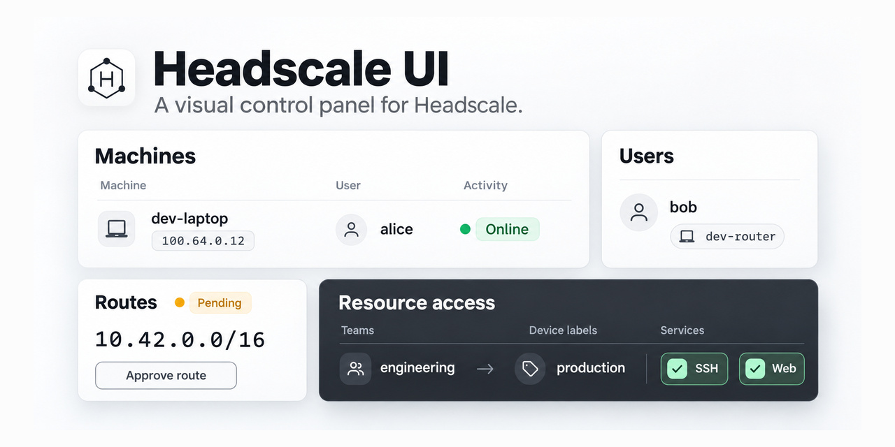

# Headscale UI



A web interface for managing a private Headscale tailnet: machines, users, auth
keys, routes, and access policies.

> Independent project; not an official Headscale, Tailscale, or WireGuard product.

## Features

- Multiple server profiles with individually password-encrypted API keys.
- Machine and user management, search, filters, and device registration.
- Reusable or ephemeral auth keys with expiration, ACL tags, and `tailscale up` commands.
- Subnet and exit-route approval, plus SSH check approval or rejection.
- Visual policy editing for ACLs, groups, and tag owners, with a server-side dry run.
- 11 languages, Arabic RTL support, and light, dark, or system themes.

## Quick start

Use **Bun 1.4.4** for all JavaScript commands.

```bash
bun install --frozen-lockfile
```

```bash
bun run dev
```

Open the printed URL and add a server profile with:

- An absolute HTTP(S) server URL, without credentials, query, or fragment.
- A Headscale API key.
- A profile password of at least 8 characters.

Profiles can be saved while the server is unavailable, but opening the console
requires a successful connection. The browser calls Headscale directly: use the
same origin or configure [CORS](#connecting-to-headscale). HTTPS or loopback
localhost, SharedWorker, and Web Crypto support are required.

For a disposable local tailnet, see the [contributor playground](e2e/ai/README.md).
Its seed and reset commands write credentials and data or delete fixture volumes;
never run them against a tailnet you need to keep.

## Credentials and sessions

- API keys are stored in IndexedDB using AES-256-GCM and a per-profile
  password-derived PBKDF2 key. Passwords and derived keys are not saved. There is
  no password recovery: replace the API key and password, or delete the profile.
- Legacy records migrate explicitly, one profile at a time; password-encrypted
  records also need the old password. Failed migrations preserve the original.
  Conflicting writes require a retry; changing active credentials locks the session.
- A SharedWorker holds the unlocked API key and makes authenticated requests.
  Same-origin tabs in one storage partition share one active server. A successful
  switch affects all peers; a failed unlock preserves the existing session.
- Sessions lock after 30 minutes without trusted user activity in a visible page.
  Polling, synthetic events, mouse movement, and page focus do not extend them.
  A refresh rejoins a live Worker session; otherwise the password is required.
  Closing the last tab does not guarantee immediate Worker memory erasure.
- Logout locks all peers. Session changes clear generated credentials. Old drafts
  cannot be submitted to the new server, and stale responses cannot update its UI;
  discard old drafts to continue. Locking discards unsaved Access edits and
  reports this on login.
- Logout and timeout do not revoke Headscale API keys or undo server writes.
  A lost write response may mean the operation committed; writes are not retried
  automatically. Read back the server state before retrying.
- The remember option controls profile visibility, not physical deletion.
  Temporary encrypted rows can survive reload or browser session restoration;
  explicitly delete the profile or clear local data to remove them.
- Encryption protects stored credentials while locked, not an unlocked app from
  malicious same-origin scripts, browser extensions, or a compromised device.
  An unavailable or incompatible Worker blocks administration; there is no per-tab fallback.

Before upgrading, close or refresh old UI tabs. Storage uses database version 3;
old connections can block upgrades. Do not clear or downgrade the database to
recover: rollback builds must support version 3, or use an independently preserved
pre-upgrade browser profile.

## Policy compatibility

- Label-to-label network access can be configured visually. New source choices
  use declarations in the current policy draft, not device or auth-key
  observations alone. Adding access does not change tag owners or create a
  reverse rule. New access rows keep the existing default network port 22;
  confirm custom ports before clearing the last preset.
- The designer reads JSON and HuJSON. Invalid or unrepresentable policies become
  read-only: policy saves and related member changes are blocked, preserving the
  original text. Correct the policy in Headscale and refresh to resume editing.
  Member deletion can proceed only with policy cleanup explicitly disabled.
- Unmodeled top-level and ACL fields, including `proto`, survive edits. Split
  destinations retain their restrictions. Aggregate service controls are read-only
  when contributing ACLs have extra fields; explicit access removal remains available.
  Saves normalize to JSON and remove comments and formatting.
- Group and tag renames or deletions update supported references, including SSH,
  grants, route approvers, and tests. Unknown reference structures block the change
  without losing the draft. Renaming a policy tag does not retag devices.
- Empty ACLs stay empty. Grants-only documents do not gain an allow-all ACL;
  grants have no dedicated editor. Headscale validates policy semantics and has
  additional [policy limitations](https://headscale.net/stable/ref/policy/#limitations).
- API writes require `policy.mode: database`. File mode without `policy.path` is
  read-only; with a path, reads work but saves fail with an explanation and retain
  the draft. The Access page can dry-run a draft without saving.
- Saves replace the whole policy without a concurrent-update check. The returned
  document becomes the saved baseline while newer local edits remain intact.
  Member policy actions write only their own change and are disabled while Access
  has unsaved edits; save or discard those edits first.

## Deployment

The hosted UI is at https://headscale.lyz.cloud. Non-prerelease GitHub Releases
publish it directly, since CI already ran on the merged commit; the Pages
workflow can also deploy a selected ref manually to that same production site. Ordinary pushes and pull requests do not
publish it. Environment protection and approval rules still apply.

### Docker

Release images support `linux/amd64` and `linux/arm64`. Use a release tag or
`latest` for the latest non-prerelease release:

```bash
docker run --rm -p 8080:80 ghcr.io/munmunmiao/headscale-ui:latest
```

Open http://localhost:8080. To serve under a subpath:

```bash
docker run --rm -p 8080:80 -e BASE_PATH=/admin/ ghcr.io/munmunmiao/headscale-ui:latest
```

Open http://localhost:8080/admin/. `BASE_PATH` defaults to `/`, accepts nested
paths, and adds a missing trailing slash. Paths must start with `/`; segments may
contain ASCII letters, digits, `.`, `_`, `~`, and `-`, but cannot be empty, `.` or
`..`. URLs, encoded characters, whitespace, queries, fragments, and the reserved
`__HEADSCALE_UI_BASE__` marker are rejected. Recreate the container after changing
the value; no image rebuild is needed. Paths outside the prefix return 404.

Reverse proxies must preserve the prefix: use `proxy_pass http://headscale-ui:80`
**without a trailing slash**. `BASE_PATH` changes only the UI path, not the
Headscale API URL.

### Static hosting

```bash
PAGES_BASE=/admin/ bun run build
```

Serve `dist/` at `/admin/`, falling back to `/admin/index.html` for page routes
and returning 404 for missing assets. `PAGES_BASE` is build-time configuration;
Docker's `BASE_PATH` is runtime configuration. GitHub Pages uses `/` and publishes
an `index.html` copy for each fixed page route so direct visits return HTTP 200
(after a possible trailing-slash redirect). A `404.html` copy remains for legacy
and unknown URLs, but those fallback responses still carry HTTP 404.

### Connecting to Headscale

**Recommended:** serve the UI and Headscale through one HTTPS origin. Run the UI
with `BASE_PATH=/admin/` and use these locations in the TLS reverse proxy:

```nginx
location = /admin {
    return 308 /admin/$is_args$args;
}

location /admin/ {
    proxy_pass http://headscale-ui:80;
}

location / {
    proxy_pass http://headscale:8080;
}
```

Enter `https://headscale.example.com` as the server URL. The catch-all preserves
Headscale's API and control endpoints; no CORS configuration is needed.

For separate origins, place a CORS proxy before Headscale: answer unauthenticated
`OPTIONS` requests with `204`, allow the exact UI origin, methods `GET, POST, PUT,
DELETE, OPTIONS`, and headers `Authorization, Content-Type`. Include `Vary: Origin`
and CORS headers on error responses too. Stock Headscale does not provide the
required CORS responses. An HTTPS UI cannot call a plain-HTTP API (mixed content).

The Docker image sets CSP, frame denial, `nosniff`, and a no-referrer policy;
see [docker/nginx.conf](docker/nginx.conf) for custom hosting. Preserve the
SharedWorker response's `connect-src http: https:` exception so it can reach
user-configured servers. Static hosts may not support these headers.

## Development and verification

Built with React, shadcn Base UI, Tailwind CSS, TanStack Router, LinguiJS, Defjs,
and Effect; Vite builds the app, and Vitest and Playwright test it.
See [AGENTS.md](AGENTS.md) for contribution rules, coverage, and translation workflow.
Use Bun, not Node.js, npm, npx, Yarn, or pnpm.

Before shipping, run each command in order; each must exit successfully:

```bash
bun run --parallel lint format:check typecheck
```

```bash
bun run i18n:check
```

```bash
bun run test
```

```bash
bun run build
```

```bash
bun run e2e
```

Tests require 100% statements, branches, functions, and lines per covered file.
Docker Compose is required for E2E and some macOS unit checks. Install the pinned
Chromium once:

```bash
bun run browser:install
```

`e2e` runs the main, policy-lifecycle, shared-session, and deployment harnesses
against disposable Headscale services. CI runs the first four commands, not E2E.
The manual playground does not replace the automated suites. GUI acceptance covers
validated actions, correct API requests, public API readback, feedback, and recovery;
SSH execution, network forwarding, and private server internals are outside its scope.
Local checks do not prove that remote publication succeeded.
